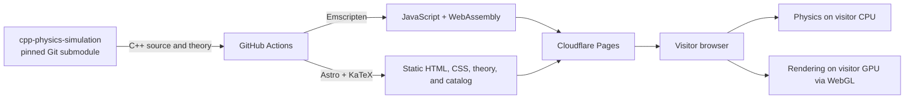
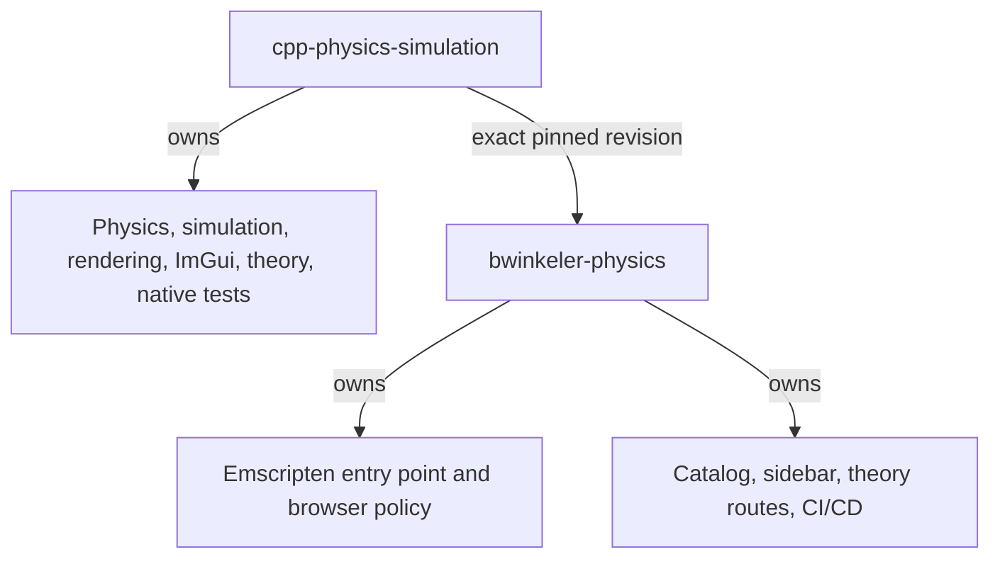

# BWinkeler Physics Lab

A static, expandable catalog of interactive physics simulations and their
physical theory. Existing C++20 simulations are compiled to WebAssembly with
Emscripten and rendered through Raylib, Dear ImGui, and WebGL directly in the
visitor's browser.

The first published laboratory is the simple and double pendulum simulation.
Ballistics and gas/Brownian motion are represented in the data-driven catalog
as planned laboratories.

## Architecture



Cloudflare serves static files and performs no physics calculations. The
platform VPS, Caddy, PostgreSQL, and Listly are not in the runtime path.

The source boundary is deliberate:



The web build compiles selected public Project 2 sources but excludes the
native `main.cpp` and `PendulumApplication.cpp`. This keeps the native
repository focused on local C++ applications without functional web changes.

## Site structure

- `/` — simulation catalog.
- `/simulations/pendulum/` — interactive WebAssembly simulation.
- `/simulations/pendulum/theory/` — canonical Markdown theory rendered with
  KaTeX and accessible MathML.
- `src/data/simulations.ts` — validated source of navigation, routes, status,
  source paths, and runtime metadata.

The collapsible sidebar and catalog are generated from this registry. A new
simulation should add one registry entry, one browser adapter/bundle, and one
canonical theory document rather than modifying navigation templates.

## Prerequisites

- Node.js 22.14.0 or a compatible newer version
- npm 10 or newer
- Git with submodule support
- Docker Desktop for the reproducible local Emscripten build

## Initial setup

Clone recursively, or initialize the submodule after an existing clone:

```text
git submodule update --init --recursive
npm ci
```

## Development

Build the WebAssembly runtime with the pinned Emscripten 6.0.5 container:

```text
./scripts/build-web.ps1
```

Then start Astro:

```text
npm run dev
```

Generated WebAssembly files are written under `public/runtime/` and are ignored
by Git. The Astro site remains usable without them and displays an explicit
runtime-not-built fallback.

## Validation

```text
npm run validate
```

This checks formatting, lint, Astro/TypeScript diagnostics, registry/content
tests, and the static production build. Changes to C++ source selection,
dependency pins, or browser adapters must additionally rebuild WebAssembly and
be exercised in a browser.

## Deployment

GitHub Actions builds native tests, WebAssembly, and Astro output before using
Wrangler to deploy the prebuilt `dist` directory to the `bwinkeler-physics`
Cloudflare Pages project. The intended production origin is
`https://physics.bwinkeler.com`.

See [docs/OPERATIONS.md](docs/OPERATIONS.md) for deployment and rollback, and
[docs/SERVICE_MANIFEST.md](docs/SERVICE_MANIFEST.md) for the operational
contract.

## License

MIT. See [LICENSE](LICENSE) and [THIRD_PARTY_NOTICES.md](THIRD_PARTY_NOTICES.md).
