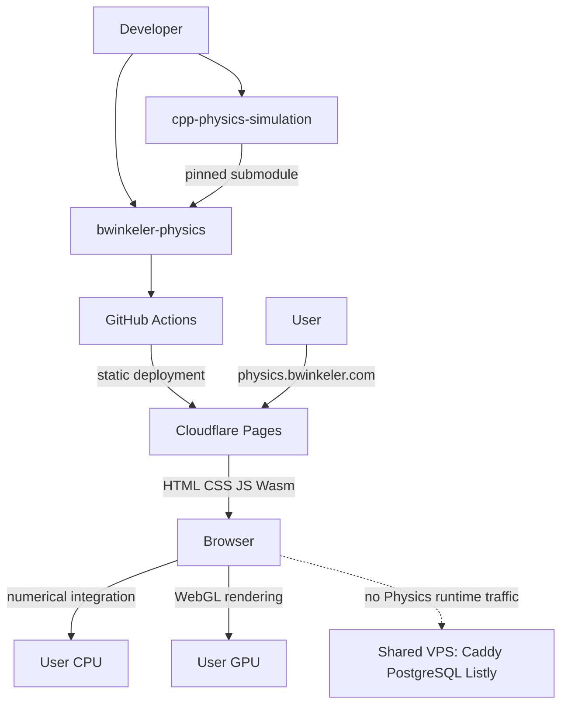
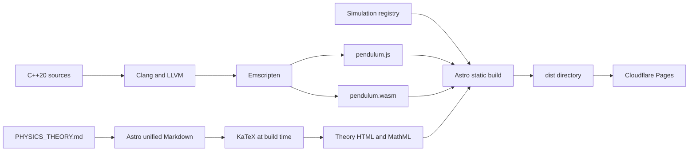
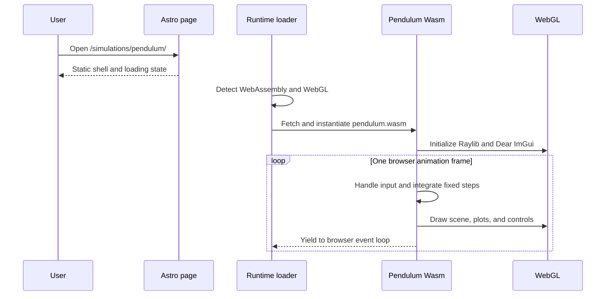

# Physics Lab architecture

## Goals

- Publish interactive physics simulations without installation.
- Keep the native C++ repository focused on local applications.
- Display canonical physical theory beside each simulation.
- Scale the catalog without loading every runtime or editing navigation by hand.
- Keep production static, inexpensive, portable, and independent of the VPS.

## System context

The dashed relationship is intentionally absent in production. Cloudflare
serves files; it does not execute the simulation.

## Build pipeline

Emscripten is the compiler toolchain. WebAssembly is the portable executable
format produced by that toolchain. JavaScript glue connects WebAssembly to
browser APIs such as canvas, keyboard, mouse, and WebGL.

## Runtime sequence

The adapter uses a returning Emscripten main-loop callback. It does not retain
the native blocking `while` loop and does not use Asyncify.

## Repository boundary

### Native source repository owns

- physics state and equations;
- numerical integrators;
- simulation stepping and retained histories;
- Raylib rendering;
- Dear ImGui controls and plots;
- native entry points, CMake presets, and tests;
- canonical `PHYSICS_THEORY.md` documents.

### Web repository owns

- the Emscripten toolchain and CMake graph;
- browser entry points and frame-work policy;
- feature detection, loading, and failure states;
- the Astro site and responsive navigation;
- theory rendering, routes, and table of contents;
- browser tests, artifact budgets, and deployment.

The web build compiles selected source files from the submodule but excludes the
native Project 2 `main.cpp` and `PendulumApplication.cpp`. CI must detect drift
between the native source list and the web source list.

## Catalog model

`src/data/simulations.ts` is the source of truth for:

- stable ID and route;
- title, description, category, and order;
- publication status;
- engine and source directory;
- canonical theory file;
- runtime artifact URL;
- minimum supported viewport.

The sidebar, home catalog, simulation route, and theory route derive from that
registry. Published entries must have both theory and runtime artifacts.

## Content model

Astro's build-time content collection reads theory directly from the pinned
submodule. `remark-math` parses LaTeX notation and `rehype-katex` creates static
HTML plus MathML. Catalog and theory pages do not load a WebAssembly runtime.

## Performance model

At 60 Hz, one complete frame has approximately:

$$
\frac{1000}{60} \approx 16.7\ \text{ms}
$$

This budget includes physics, UI, and rendering. The browser adapter clamps an
anomalous frame delta and limits the requested simulation time to 1,000 fixed
substeps per rendered frame. When that cap is reached, simulated time slows down
and the UI reports `Performance limited` instead of monopolizing the browser
thread.

For future heavy simulations, scale in this order:

1. improve algorithmic complexity and data structures;
2. cap retained data and adapt visual detail;
3. profile optimized WebAssembly and WebGL calls;
4. evaluate Wasm SIMD;
5. move pure CPU work to a Web Worker;
6. evaluate a separate pthread build only with measured justification.

## Hosting scale

All simulations remain in one Pages project and each simulation has an
independent runtime directory. The browser downloads only the selected bundle.
More simulations do not add CPU or memory load to the server.

Current limits that trigger review:

- 25 MiB per Pages asset;
- 20,000 files per Pages project on the Free plan;
- unacceptable CI/deploy duration;
- unacceptable client startup or frame performance.

If immutable runtime assets outgrow Pages, an ADR may move only those artifacts
to R2 with a dedicated asset hostname. The shared VPS is not the default static
asset scaling path. Server-side compute requires a separate design and capacity
plan.

## Future engines

A future engine must have maintained, direct Emscripten/browser support and a
WebGL- or WebGPU-compatible rendering path. SDL3 is eligible for evaluation. Qt
and arbitrary native binaries are out of scope. Every engine receives its own
bundle so toolchain and dependency requirements remain isolated.
